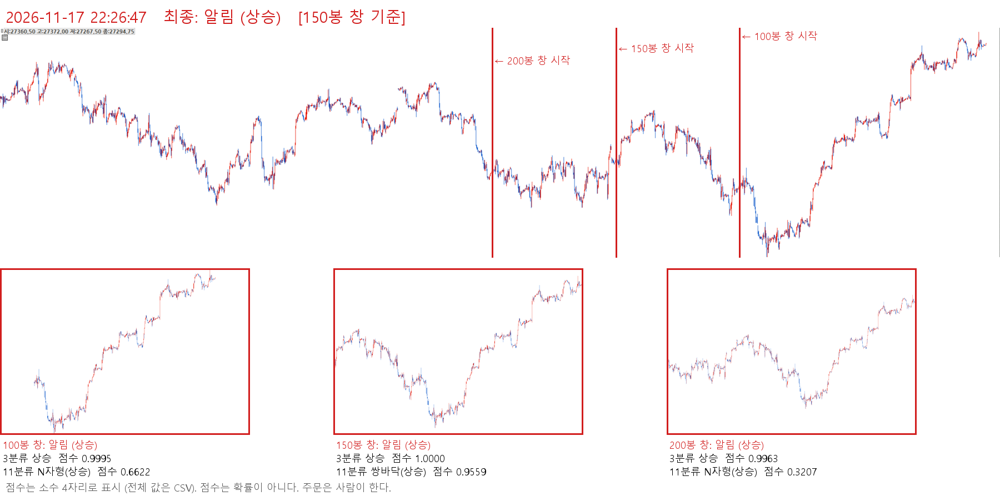
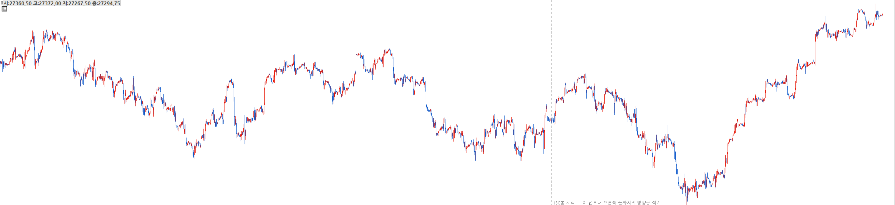

# 큰 봉 차트 방향 알림 도우미 (PoC 1차)

> 모두의연구소 AI 수업 Main Quest 2 — "내 업무 어디에 AI를 넣을까"
> 나스닥100 선물을 직접 매매하면서 HTS 차트를 오래 지켜봐야 하는 문제를, **큰 봉·작은 봉 차트의 방향(상승/하락/없음)을 AI로 판정해 알리고 기록하는 도우미**로 줄여 보는 PoC입니다. 그리고 **내 판단과 AI 판정을 실제 가격 변화로 채점하는 실전 기록**을 함께 만듭니다.

**주의:** 이 프로그램은 매매와 연결되어 있지 않습니다. **알림과 기록만** 하며, 주문은 사람이 직접 합니다. 투자 조언이 아닙니다.

> 패턴은 300분·10분·1분 등 분봉과 상관없이 비슷하게 나타난다(사용자의 다년간 매매 경험). 이 PoC는 300분봉으로 학습한 AI가 다른 분봉에서도 같은 패턴을 알아보는지를 **실전 기록의 분봉별 결과로** 확인한다.

---

## 1. 무엇을 하나

### ① 알림 도우미 (`run_poc.py`)

```text
HTS 화면 ──(5분마다, 차트 영역만 캡처)──▶ 화면 위 "큰 봉" 차트 + 아래 "작은 봉" 차트
            │ 다른 창에 가려짐 → "확인 불가" (판정·저장 안 함)
            ▼
   차트마다 최근 100·150·200봉 창으로 자르기 → YOLO11n 방향 3분류 + 패턴 11분류 (내 PC CPU)
            ▼
   알림 규칙: 두 모델이 같은 방향일 때만 "알림", 다르면 "애매(쉬어 가기)", 둘 다 없음이면 "없음"
            ▼
   진입 확인: 큰 봉 알림 방향 = 작은 봉 알림 방향 → "진입 확인 (주문은 직접)" 알림 창
            ▼
   콘솔 · 알림 창 · CSV 기록(모든 점수) · 확인용 이미지
```

### ② 실전 기록 (`record_live.py` → `evaluate_live.py`)

```text
[아무 때나] Ctrl+Alt+J
   → 두 차트 캡처 + 현재가 OCR(p0) + AI 판정 (따로 저장, 화면에 안 보여 줌)
   → 선택 창: [지금 차트 / 과거 차트] + 큰 봉 분봉(지난번 값) + [오른다] [내린다] [모르겠다] + 메모
     (과거 차트: [올랐음] [내렸음] [횡보] = 다음 20봉 안의 실제 결과, 가격 확인 예약 안 함)
[30분 · 2시간 · 1일 뒤] 현재가 OCR(p1) → 변화가 기준 폭(20 · 40 · 100포인트) 이상이면 올랐음/내렸음, 아니면 변동 작음
[기록이 쌓인 뒤] 결과 표: 내 판단 · AI · 나와 AI가 같을 때 · 늘 오른다 — 시간별, 큰 봉 분봉별 적중률
```

- 문제 정의: [problem_definition.md](problem_definition.md)
- 모델 선정 근거 (규칙 코드, SigLIP 2, YOLO 비교): [model_comparison.md](model_comparison.md)
- 단계별 실험·관찰 기록: [진행기록/](진행기록/) — PoC 관찰은 [12](진행기록/12_PoC_관찰_기록.md), 실전 기록 설계는 [13](진행기록/13_실전기록_설계.md)

## 2. 폴더 구조

```text
MainQuest2/
├─ README.md                  이 파일
├─ problem_definition.md      문제 정의서
├─ model_comparison.md        모델 선정 근거
├─ data/
│  ├─ 원본캡처/               HTS 300분봉 화면 10장
│  ├─ 학습용/<패턴>/          학습 사진 68장 (패턴 11종)
│  ├─ 시험용/<패턴>/          시험 사진 (학습에 쓰지 않음) + 라벨의심.csv
│  └─ 시험용_분봉/<분봉>/      분봉별 과거 차트 시험 사진 (보류 중)
├─ code/
│  ├─ poc/                    ★ PoC 본체 (실행방법.md 참고)
│  ├─ yolo_direction/         교차검증 실험 (진행기록 07–11)
│  ├─ siglip/                 SigLIP 2 실험 (진행기록 06)
│  └─ 실험1/                  첫 실험·규칙 코드 (클라우드용, 참고)
├─ models/                    최종 모델 (dir3.pt, cls11.pt — GitHub에 없음, train_final.py로 만듦) + 학습 정보 json
├─ 진행기록/                  00–13 기록, 시험결과/, 시연/
└─ logs/                      실행 기록 (GitHub에 올리지 않음)
```

`code/poc/` 안의 파일:

| 파일 | 하는 일 |
| --- | --- |
| `preprocess.py` | 학습·판정 공통 전처리 (빨강·파랑 봉만 남기고 450×300) |
| `train_final.py` | 학습용 사진 전체로 최종 모델 2개 학습 |
| `setup_region.py` | 차트 영역 좌표 도우미 (초록 날짜 축·가격 축으로 큰 봉·작은 봉 영역 자동 추정) |
| `capture.py` | 차트 영역만 캡처, 날짜·시각 이름으로 저장, 설정 읽기 |
| `judge.py` | 차트인지 확인, 봉 간격 재기(확대 비율 경고), 판정 창 자르기, 두 모델 판정 |
| `rules.py` | 알림 규칙, 창 묶기 규칙, 진입 확인 규칙 |
| `report.py` | 콘솔 한 줄, CSV, 확인용 이미지 |
| `run_poc.py` | ① 알림 도우미 정기 실행 (캡처 → 판정 → 기록 → 알림) |
| `price_ocr.py`, `setup_price.py` | 현재가 OCR (차트 위 현재가 칸 + 가격 축 현재가 상자를 같이 읽어 비교) |
| `record_live.py` | ② 실전 기록 (단축키 → 내 판단 선택 창, 정해 둔 시간 뒤 가격 자동 기록) |
| `evaluate_live.py` | ② 실전 기록 결과 표 |
| `test_preprocess.py` | 전처리 일치·규칙 테스트 (15개) |
| `evaluate_model.py`, `evaluate_practice.py` | 모델 시험(`data/시험용`), 알림 도우미 실전 시험(정답표) |
| `capture_test.py`, `evaluate_timeframe.py` | 분봉별 과거 차트 시험 (보류 중) |
| `config.json` | 모든 설정 (차트 영역·봉 간격, 창 폭, 규칙, 현재가 칸, 단축키, 시간·기준 폭 등) |

## 3. 설치 (Windows, 처음 한 번)

VS Code에서 이 폴더를 열고 **터미널 → 새 터미널**에서 한 줄씩 실행합니다.

```powershell
py -3.12 -m venv .venv
.\.venv\Scripts\Activate.ps1
$env:PYTHONUTF8 = '1'
pip install torch==2.15.0 --index-url https://download.pytorch.org/whl/cpu
pip install -r code\poc\requirements.txt
```

- "스크립트를 실행할 수 없습니다" → `Set-ExecutionPolicy -Scope CurrentUser RemoteSigned` 후 다시
- `UnicodeDecodeError: 'cp949'` → `$env:PYTHONUTF8 = '1'`을 먼저 실행
- GPU는 필요 없습니다 (CPU로 학습·판정).
- 현재가 OCR은 윈도우 내장 OCR을 씁니다 (`requirements.txt`의 `winrt-…` 묶음).

## 4. 실행 방법

아래 명령은 모두 `.venv`를 켠 상태(`.\.venv\Scripts\Activate.ps1`, `$env:PYTHONUTF8 = '1'`)에서 실행합니다. 자세한 설명, 클릭 순서, 자주 나는 문제는 [code/poc/실행방법.md](code/poc/실행방법.md)에 있습니다.

### 준비 (처음 한 번)

| 순서 | 명령 | 언제 | 결과 |
| --- | --- | --- | --- |
| 1 | `python code\poc\train_final.py` | 처음, 학습용 사진이 바뀌었을 때 | `models\dir3.pt`, `models\cls11.pt` (+ 학습 정보 json) |
| 2 | `python code\poc\test_preprocess.py` | 코드를 고친 뒤 | "전부 통과" (15개) |
| 3 | `python code\poc\setup_region.py --monitor 2 --delay 5` | 처음, HTS 창 위치를 바꿨을 때 | 큰 봉(위)·작은 봉(아래) 차트 영역, `logs\setup\` 확인용 사진 |
| 4 | `python code\poc\setup_price.py` | 처음, HTS 창 배치를 바꿨을 때 | 현재가를 5번 읽어 HTS와 같은지 확인 |

### ① 알림 도우미

| 명령 | 결과 |
| --- | --- |
| `python code\poc\run_poc.py --once` | 한 번 판정: 콘솔 `[큰 봉] … / [작은 봉] … / [진입 확인] …`, 알림 창(닫을 때까지 대기), `logs\` 기록 |
| `python code\poc\run_poc.py` | 5분마다 반복 (Ctrl+C로 멈춤). 알림 창은 하나만 유지 |

### ② 실전 기록 (run_poc는 끄고 — AI 판정이 보이므로)

| 명령 | 결과 |
| --- | --- |
| `python code\poc\record_live.py` | 켜 두고 아무 때나 **Ctrl+Alt+J** → 선택 창에서 큰 봉 분봉 확인 후 오른다/내린다/모르겠다. 30분·2시간·1일 뒤 가격 자동 기록 (`logs\실전기록\`) |
| `python code\poc\evaluate_live.py` | **기록이 30건 이상 쌓인 뒤** 결과 표 → `진행기록\시험결과\실전기록_<시각>.md` |
| `python code\poc\evaluate_live.py --thr 30분=25,1일=80` | 기준 폭만 바꿔 다시 계산 |

**실행하는 동안 HTS 차트가 다른 창에 가려지지 않게**, 마우스는 큰 봉 차트 밖에 둡니다. HTS 봉은 **속이 찬 봉**으로 둡니다.

## 5. 시연 자료

> 아래는 **학습에 쓴 원본캡처03**을 화면 대신 넣어 만든 예시입니다. 화면 구성을 보여 주기 위한 것이며 성능의 근거가 아닙니다. 실제 화면 기록은 `logs/`에 남고 GitHub에는 올리지 않습니다.

**콘솔 한 줄 요약** ([진행기록/시연/콘솔_예시.txt](진행기록/시연/콘솔_예시.txt))

```text
2026-11-17 22:26:47 | 알림(상승) [150봉 창 기준] | 150봉 창: 3분류 상승 점수 0.9999648332595825 | 11분류 참고: 쌍바닥 모양과 비슷 (상승) 점수 0.9558824300765991 | 다른 창: 100봉 알림(상승), 200봉 알림(상승)
```

**확인용 이미지** — 위: 차트 영역과 판정 창 시작 위치, 아래: 창마다 모델에 들어간 사진과 판정



**실전 시험 정답 적기용 사진** — 판정 결과를 보여 주지 않음 (회색 점선 = 150봉 창 시작)



## 6. 결과 (시험 후 채움)

성공 기준은 [problem_definition.md 5장](problem_definition.md)에 모델을 돌리기 전에 적어 두었습니다. 최종 성능은 **학습에 쓰지 않은 사진**과 **실전 기록**으로만 잽니다.

**실전 기록** (시간마다 따로, 적중률 = 방향을 말한 것 중 맞은 비율, 변동 작음은 틀림으로 셈)

| 누구 | 30분 뒤 (20pt) | 2시간 뒤 (40pt) | 1일 뒤 (100pt) |
| --- | --- | --- | --- |
| 내 판단 | 시험 후 채움 | 시험 후 채움 | 시험 후 채움 |
| AI 큰 봉 알림 (두 모델 일치) | 시험 후 채움 | 시험 후 채움 | 시험 후 채움 |
| AI 진입 확인 (큰 봉 = 작은 봉) | 시험 후 채움 | 시험 후 채움 | 시험 후 채움 |
| 나와 AI(큰 봉 알림)가 같을 때 | 시험 후 채움 | 시험 후 채움 | 시험 후 채움 |
| 늘 오른다 (비교 기준) | 시험 후 채움 | 시험 후 채움 | 시험 후 채움 |

**숫자 목표** ([problem_definition.md 5장](problem_definition.md), 결과 표를 보기 전에 정함. 결과 표가 시간마다 통과 / 미달 / 판단 보류를 보여 줌)

| 번호 | 목표 | 30분 뒤 | 2시간 뒤 | 1일 뒤 |
| --- | --- | --- | --- | --- |
| ⑪ | AI 큰 봉 알림 ≥ (늘 오른다·늘 내린다 중 높은 쪽) + 10%p → 쓸 만하다 (큰 봉 알림 10건 이상) | 시험 후 채움 | 시험 후 채움 | 시험 후 채움 |
| ⑫ | 나와 AI가 같을 때 ≥ 내 판단 + 10%p → 확인용으로 쓸 만하다 (같을 때 10건 이상) | 시험 후 채움 | 시험 후 채움 | 시험 후 채움 |
| ⑬ | 각 분봉의 AI 큰 봉 알림이 300분봉과 15%p 이내 → 분봉 가설 지지 (분봉마다 10건 이상) | 시험 후 채움 | 시험 후 채움 | 시험 후 채움 |

기록이 30건 정도면 우연으로도 적중률이 ±10%p쯤 흔들립니다(95% 범위로는 약 ±18%p). 그래서 10%p 안팎의 차이는 확실하다고 보지 않고 기록을 더 모읍니다.

**큰 봉 분봉별** — 300분봉으로 학습한 AI가 다른 분봉에서도 통하는지

| 큰 봉 분봉 | 기록 수 | 내 판단 | AI 큰 봉 알림 | 늘 오른다 |
| --- | --- | --- | --- | --- |
| 300분 (학습한 분봉) | 시험 후 채움 | 시험 후 채움 | 시험 후 채움 | 시험 후 채움 |
| 60분 | 시험 후 채움 | 시험 후 채움 | 시험 후 채움 | 시험 후 채움 |
| 10분 | 시험 후 채움 | 시험 후 채움 | 시험 후 채움 | 시험 후 채움 |
| 3분 · 1분 | 시험 후 채움 | 시험 후 채움 | 시험 후 채움 | 시험 후 채움 |

**과거 차트** (HTS를 과거로 넘겨서 기록, 실제 결과 = 다음 20봉 안에 확실히 오르면 올랐음 / 내리면 내렸음 / 아니면 횡보)

| 누구 | 적중률 |
| --- | --- |
| AI 큰 봉 3분류 / 큰 봉 알림 / 진입 확인 | 시험 후 채움 |
| 큰 봉 3분류 세 갈래 (없음 = 횡보) | 시험 후 채움 |
| 늘 오른다 / 늘 내린다 (비교 기준) | 시험 후 채움 |

**사진 시험** (성공 기준 ①–⑧)

| 기준 | 목표 | 결과 |
| --- | --- | --- |
| ① 방향 판정 | 시험 사진 30장 중 80% 이상 | 시험 후 채움 |
| ② 방향 + 단계 판정 | 70% 이상 | 단계 판정 미구현 (다음 스텝) |
| ③ "지남" 구분 | 5장 중 1장 이하 오알림 | 단계 판정 미구현 (다음 스텝) |
| ④ 일관성 | 같은 사진은 같은 결과 | 시험 후 채움 |
| ⑤ 처리 시간 | 1장 30초 이내 | 시험 후 채움 |
| ⑥ 학습 효과 | 학습 모델 > 규칙 코드·제로샷 | 시험 후 채움 |
| ⑦ 실패 분석 | 5건 이상 | 시험 후 채움 (개발 중 실패 사례는 [진행기록 12](진행기록/12_PoC_관찰_기록.md), [13](진행기록/13_실전기록_설계.md)) |
| ⑧ 가격 조건 정확도 | 10건 모두 눈금 한 칸 이내 | 가격 조건 미구현 (다음 스텝) |

모델을 고를 때 쓴 학습용 사진 교차검증 결과는 [model_comparison.md](model_comparison.md)에 있습니다. 그 숫자는 **참고용**입니다. 라벨 수정과 회차 선택(best.pt) 때문에 실제보다 높게 나올 수 있다는 것을 확인했습니다([진행기록 10](진행기록/10_라벨수정2_재실험_결과.md), [11](진행기록/11_last회차_교차검증_결과.md)).

## 7. 재현성

- **같은 결과 다시 만들기:** `train_final.py`는 seed 0, 40 epoch, 224px로 학습하고 마지막 회차(last.pt)를 저장합니다. 모델 옆 json에 학습 날짜, 사진 수, 학습 사진 목록, ultralytics 버전이 남습니다. 교차검증은 같은 설정에서 68장 모두 같은 예측이 재현됨을 확인했습니다(진행기록 11).
- **전처리 일치:** `test_preprocess.py`가 같은 원본을 학습 경로·판정 경로로 처리해 사진과 점수가 같은지 확인합니다.
- **기록:** CSV 한 줄마다 모델 파일(학습 날짜·md5)과 설정값(창 폭, 규칙, 최소값, 창 묶기, 기준 창, 봉 간격)을 남겨, 설정을 바꾼 전후 결과를 구분할 수 있습니다. 점수는 반올림하지 않고 그대로 저장합니다.
- **실전 기록:** 가격(p0, p1)과 변화량을 그대로 남기므로, 기준 폭을 바꿔 언제든 다시 채점할 수 있습니다. 현재가 검산 사진도 남습니다.
- 모델 파일(`*.pt`)은 GitHub에 올리지 않습니다. 준비 1(`train_final.py`)로 다시 만듭니다.

## 8. 개인정보·보안

- 모든 처리는 내 PC에서 합니다. 캡처를 외부로 보내지 않고, 외부 AI API를 쓰지 않습니다. OCR도 윈도우 내장 기능입니다.
- 정기 캡처는 **차트 영역**과 **현재가 칸**만 찍습니다. 화면 전체는 좌표를 정할 때만 메모리로 쓰고, 기본으로 파일로 남기지 않습니다(`save_full_screenshot: false`).
- 차트 위에 다른 창이 있으면 판정하지 않고 사진도 저장하지 않습니다(진행기록 12의 3장).
- `logs/`는 `.gitignore`에 있어 GitHub에 올라가지 않습니다.

## 9. 한계와 다음 스텝

자세한 내용: [진행기록/12](진행기록/12_PoC_관찰_기록.md), [진행기록/13](진행기록/13_실전기록_설계.md), [model_comparison.md 8장](model_comparison.md)

- **학습 사진 68장**(300분봉)뿐이고, "없음(횡보)"은 8장입니다. 학습할 때마다 예측이 10–15장씩 바뀔 만큼 흔들립니다.
- **학습 사진과 판정 창의 차이:** 학습 사진은 보통 89봉인데 기준 창은 150봉이라 봉이 빽빽합니다. 200봉 창에서 "횡보"가 많이 나옵니다.
- **질문의 시간이 다를 수 있음:** AI는 큰 봉 150개짜리 모양의 방향을 봅니다. 그 방향이 30분·2시간 뒤 가격으로 바로 나타나지 않을 수 있습니다. 같은 30분이라도 큰 봉이 1분봉이면 30봉 뒤, 300분봉이면 봉 1개도 안 지난 시점입니다.
- **실전 기록의 독립성:** 같은 날 가까운 시각의 기록은 같은 가격 흐름을 공유합니다. 기록 수와 함께 기록한 날 수를 봅니다.
- **현재가 OCR:** 이 PC의 윈도우 OCR은 한국어 엔진이라 숫자를 한글로 읽는 일이 있습니다. 두 곳을 같이 읽어 비교하고 0.25 호가 단위로 검사해 막지만, 읽기 실패는 남습니다.
- **아직 없는 기능:** 단계(형성 중/완성/지남) 판정, 가격 조건 계산, 예측 기능(가능한 그림 후보, 예상 소요 시간).
- 다음 스텝 후보: 실전 기록 30건 이상 → 결과 표 → 기준값(최소 점수, 창 묶기, 기준 폭) 결정 → 분봉별 결과로 분봉 가설 확인 → 재학습 반복 → 단계 판정 → 가격 조건.
- (여유가 되면) HTS 차트 위쪽의 분봉 숫자 칸을 프로그램이 직접 읽어 기록하기. 지금은 실전 기록의 선택 창에서 사람이 고릅니다.

## 10. 라이선스

- YOLO11n-cls(Ultralytics)는 **AGPL-3.0**입니다. 개인 사용과 과제 제출에는 문제가 없으나, 닫힌 제품으로 배포하려면 소스 공개 또는 유료 라이선스가 필요합니다.
- SigLIP 2(실험에만 사용)는 Apache 2.0입니다.
