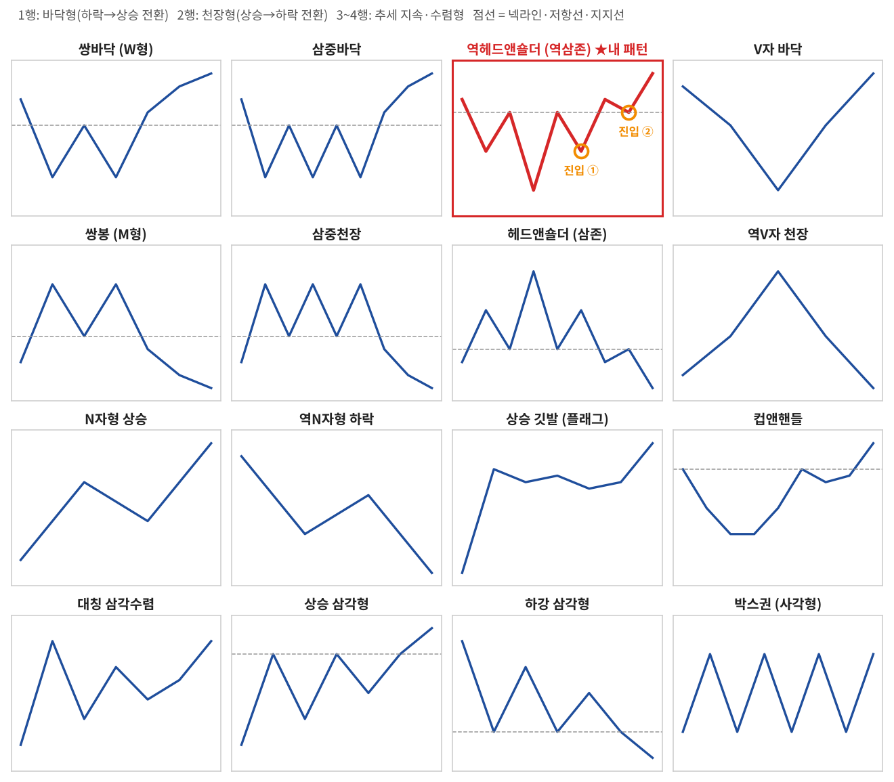

# 차트 패턴 용어 정리

> Main Quest 2 준비 자료. 문제 정의서와 라벨(정답) 이름을 정할 때 이 용어를 기준으로 씁니다.

그림은 모양을 이해하기 위한 단순한 선 그림입니다. 실제 차트는 이보다 훨씬 들쭉날쭉합니다. 점선은 넥라인, 저항선, 지지선입니다.

---

## 1. 모양을 설명하는 기본 용어

| 용어 | 뜻 | 쉽게 말하면 |
| --- | --- | --- |
| 고점 | 주변보다 높은 지점 | 산봉우리 |
| 저점 | 주변보다 낮은 지점 | 골짜기 |
| 지지선 | 가격이 내려오다 여러 번 멈춘 높이 | 바닥 역할을 하는 선 |
| 저항선 | 가격이 올라가다 여러 번 막힌 높이 | 천장 역할을 하는 선 |
| 넥라인 (목선) | 패턴 안 골짜기 사이(또는 봉우리 사이)를 이은 선 | 패턴이 완성됐는지 가르는 기준선 |
| 돌파 | 가격이 넥라인이나 저항선을 뚫고 넘어감 | 천장을 뚫음 |
| 리테스트 (되돌림, 풀백) | 돌파한 뒤 다시 그 선 근처로 살짝 내려옴 | 뚫은 천장이 이제 바닥이 되는지 확인 |
| 추세 전환형 | 오르던 흐름이 내리막으로, 또는 그 반대로 바뀌는 패턴 | 방향이 바뀜 |
| 추세 지속형 | 잠시 쉬었다가 원래 방향으로 계속 가는 패턴 | 쉬어 가기 |

## 2. 바닥형 (하락 → 상승 전환)

| 이름 | 다른 이름 | 모양 | 넥라인 |
| --- | --- | --- | --- |
| **역헤드앤숄더** ★ | **역삼존**(逆三尊), 뒤집어진 山 | 골짜기 3개, **가운데가 가장 깊음** (어깨-머리-어깨를 뒤집은 모양) | 두 봉우리를 이은 선 |
| 쌍바닥 | 이중바닥, W형, 더블 바텀 | 비슷한 깊이의 골짜기 2개 | 가운데 봉우리 높이 |
| 삼중바닥 | 트리플 바텀 | **비슷한 깊이**의 골짜기 3개 | 봉우리들 높이 |
| V자 바닥 | V자 반등 | 급하게 떨어졌다가 급하게 오름 | 없음 |
| 원형바닥 | 접시형, 라운딩 바텀 | 천천히 내려와 둥글게 바닥을 다진 뒤 천천히 오름 | 시작점 높이 |

**역헤드앤숄더와 삼중바닥의 차이:** 골짜기가 3개인 건 같지만, 역헤드앤숄더는 **가운데가 확실히 더 깊고**, 삼중바닥은 **세 개가 거의 같은 깊이**입니다.

## 3. 천장형 (상승 → 하락 전환)

바닥형을 위아래로 뒤집은 모양입니다.

| 이름 | 다른 이름 | 모양 |
| --- | --- | --- |
| 헤드앤숄더 | 삼존(三尊), 머리어깨형 | 봉우리 3개, 가운데가 가장 높음 |
| 쌍봉 | 이중천장, M형, 더블 톱 | 비슷한 높이의 봉우리 2개 |
| 삼중천장 | 트리플 톱 | 비슷한 높이의 봉우리 3개 |
| 역V자 천장 | | 급하게 올랐다가 급하게 떨어짐 |

## 4. 추세 지속·수렴형

| 이름 | 다른 이름 | 모양 |
| --- | --- | --- |
| N자형 상승 | | 오름 → 눌림 → 직전 고점을 넘어 다시 오름 |
| 역N자형 하락 | | 내림 → 반등 → 직전 저점을 깨고 다시 내림 |
| 상승 깃발 | 플래그 | 급등(깃대) 뒤 살짝 내려가는 좁은 횡보(깃발), 다시 상승 |
| 페넌트 | | 깃발과 같지만 쉬는 구간이 작은 삼각형 |
| 컵앤핸들 | | 둥근 컵 모양 바닥 + 손잡이 모양의 작은 눌림 뒤 상승 |
| 대칭 삼각수렴 | | 고점은 낮아지고 저점은 높아지며 폭이 좁아짐 |
| 상승 삼각형 | | 고점은 같은 높이(저항선), 저점은 점점 높아짐 |
| 하강 삼각형 | | 저점은 같은 높이(지지선), 고점은 점점 낮아짐 |
| 박스권 | 사각형, 횡보 | 일정한 위아래 범위 안에서 오르내림 |

## 5. 진입(매수) 시점 용어

| 내 표현 | 차트 용어 | 설명 |
| --- | --- | --- |
| 진입 ① 오른쪽 어깨 진입 | 오른쪽 어깨 매수 (선취매) | 패턴이 다 완성되기 전, 오른쪽 골짜기에서 미리 들어감. 일찍 들어가는 대신 패턴이 실패할 위험도 큼 |
| 진입 ② 돌파 후 눌림 진입 | 넥라인 돌파 후 리테스트 매수 (풀백 매수, 눌림목 매수) | 넥라인을 뚫은 뒤 다시 넥라인 근처로 내려왔을 때 들어감. 패턴 완성을 확인한 뒤라 더 안전하지만 늦음 |
| (참고) 늦은 진입 | 추격 매수 | 이미 오르고 있을 때 따라 들어감 |

## 6. 이번 PoC에서 쓸 이름

> **역헤드앤숄더(역삼존, 이하 '뒤집어진 山') 패턴의 오른쪽 어깨 매수(진입 ①)와 넥라인 돌파 후 리테스트 매수(진입 ②) 시점 판정**

라벨(정답 폴더) 이름:

| 폴더 이름 | 뜻 |
| --- | --- |
| `entry1` | 진입 ①: 오른쪽 어깨 매수 시점 |
| `entry2` | 진입 ②: 넥라인 돌파 후 리테스트 매수 시점 |
| `none` | 해당 없음 (패턴 없음, 아직 덜 만들어짐, 이미 지나감) |

## 주의

- 패턴 이름은 같아도 "얼마나 깊어야", "얼마나 비슷해야" 그 패턴으로 보는지는 사람마다 다릅니다. 그래서 다음 단계에서 **내 기준을 숫자로** 적습니다.
- 이 자료는 용어 정리이며, 어떤 패턴이 실제로 수익을 낸다는 뜻이 아닙니다.
